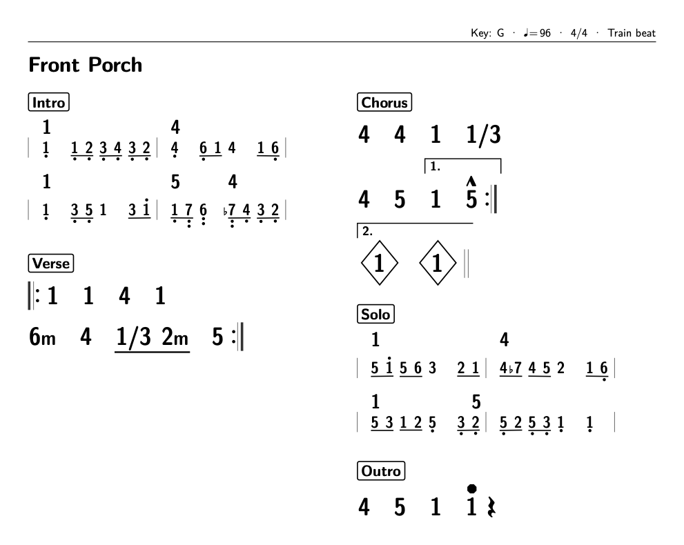
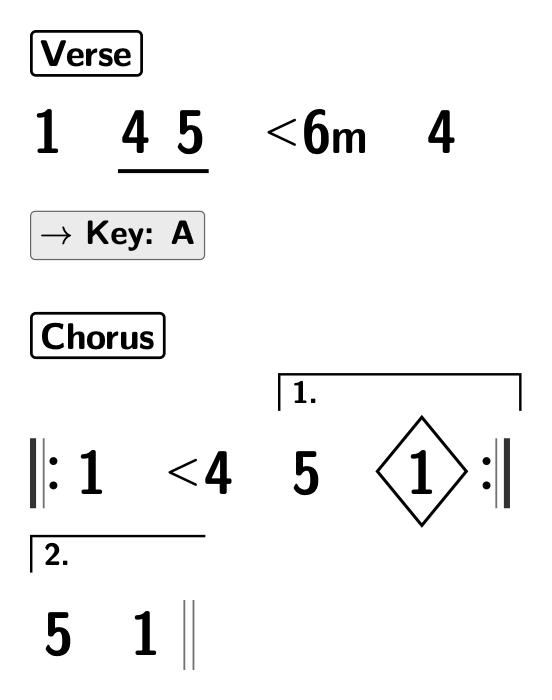
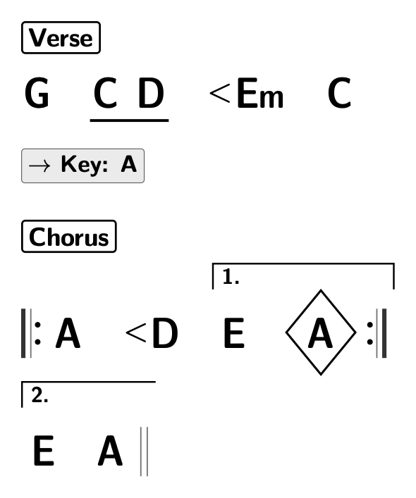
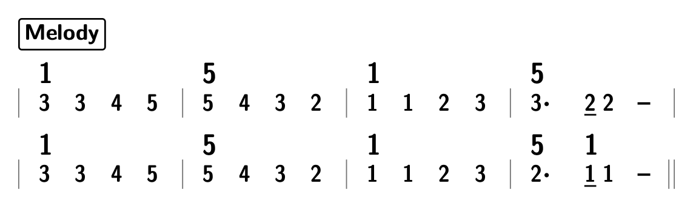

# Nashville LaTeX

Write chord charts and melodies as latex files, in numbers instead of letter
names, and build them into clean, printable PDFs with one command.

```
make pdf front-porch     # -> build/front-porch.pdf
```



## The idea: everything is a scale degree

Most chord charts are written in letters (G, C, D, Em). Change the key and
every symbol on the page changes with it. This project writes music the way
session players in Nashville do: as **scale degrees of the key**. In the key
of G, G is `1`, C is `4`, D is `5`, Em is `6m`. Move the song to A and the
chart doesn't change at all; only the key in the header does.

The same idea works for melodies. **Jianpu** (简谱, "simplified notation") is
a numbered musical notation, widely used in China and across East Asia,
where each note is a digit 1 to 7 for its degree in the key. Put the two
together and a chart's chords *and* its lead lines share one number system:
a `5` in the melody is the root of the `5` chord above it.

### Nashville numbers

Each number is one bar of that chord. A chart reads left to right like text,
with section labels and only the marks a band needs.

```latex
\songinfo{title={Name of Song}, key=G, tempo=92, time=4/4}
\begin{section}{Verse}
  \bars{ | 1 | 4 . 5 | <6m | 4 | }
\end{section}
\keychange{A}
\begin{section}{Chorus}
  \bars{ |: 1 | <4 | [1. 5 | 1* :|[2. 5 | 1 || }
\end{section}
```

| As written (numbers) | Built with `LETTERS=1` |
|:---:|:---:|
|  |  |

- `4 . 5`: two chords sharing a bar, underlined.
- `<6m`: a push; the chord arrives just before the bar line.
- `1*`: a diamond; strike the chord and let it ring.
- `|:` `:|` `[1.` `[2.`: repeats and first and second endings.
- `\keychange{A}`: the numbers carry on unchanged in the new key.

Building with `LETTERS=1` spells every chord out in the song's key, for
players who read letters. The source never changes.

### Jianpu melody lines

A section can show its lead line in jianpu, with the Nashville chords pinned
above the notes where they change.

```latex
\begin{section}{Melody}
  \melody{ [1] 3 3 4 5 | [5] 5 4 3 2 | [1] 1 1 2 3 | [5] 3. 2/ 2 - |
           [1] 3 3 4 5 | [5] 5 4 3 2 | [1] 1 1 2 3 | [5] 2. [1] 1/ 1 - || }
\end{section}
```



How to read it:

- **Digits** are scale degrees: `1` is the key's tonic (do), `5` is the
  fifth (sol). `b7` and `#4` are altered degrees.
- **Dots** move a note an octave: above for higher (`1'`), below for lower
  (`5,`).
- **Length**: a plain digit is one beat. An underline halves it (`2/` is an
  eighth note), a dot after it adds half again (`3.`), and each dash holds
  it one more beat (`2 -`).
- **`0`** is a rest. **Chords** above the line change on the note beneath
  them.

Melodies can also tie notes across bars, stack notes, and run several voices
in parallel (soprano and bass, say), all lined up on one beat grid. The
[Front Porch](songs/front-porch.tex) chart above mixes both: its intro and
solo are guitar lines in jianpu, and the rest is Nashville chord bars.

### What you get

- **Plain-text source**: one `.tex` file per song, easy to diff and keep in
  git.
- **One-command builds**: `make pdf <song>` builds a song, `make pdf` builds
  them all, and `make book` binds them into a songbook with a table of
  contents.
- **Key-independent charts**: change `key=` and nothing else, or print
  letters with `LETTERS=1`.
- **Mistakes caught at build time**: a bar that doesn't add up, an unknown
  chord or a stray mark stops the build with the section, bar and voice
  named.
- **Songbook layout**: a running head with key, tempo, time and feel, two
  columns, and sections that never split across a column or page.

Chord charts and lead lines only: no lyrics, no standard notation. macOS
only.

# Usage

## Setup

```
make install    # brew bundle (BasicTeX) + project-local TeX bits in .texmf/
make doctor     # shows resolved tools; non-zero exit if anything is missing
```

Installing the BasicTeX cask asks for your password once. Everything else lives
in the repo: extra TeX packages and latexmk go in `.texmf/` (latexmk isn't in
Homebrew and `tlmgr --usermode` refuses it, so it is fetched from CTAN as a
single script), and font caches go in `.texmf-var/`. Bravura (SIL OFL, see
`src/fonts/OFL.txt`) is committed and loaded by path.

## Commands

| Command | Behavior |
|---|---|
| `make pdf <song>` | Build `songs/<song>.tex` to `build/<song>.pdf` |
| `make pdf` | Build every song |
| `make pdf SONG=<song>` | Same as the positional form |
| `make pdf <song> LETTERS=1` | Render chord letters for the song's key -> `build/<song>-letters.pdf` |
| `make build/<song>.pdf` | Incremental file rule |
| `make book` | Bind all songs (except `_*` demos) into `build/book.pdf` |
| `make new <song>` | Scaffold `songs/<song>.tex` |
| `make list` | List songs |
| `make clean` | Remove `build/` |
| `make test` | Run the melody unit tests (`tests/melody_test.lua`) |
| `make doctor` / `make install` | See above |

The Makefile is a thin wrapper; `src/bin/nns` does the work and can be run
directly (`src/bin/nns build hello`, `src/bin/nns help`).

# Syntax

## Song format

```latex
\documentclass{nnschart}          % options: a4 (default Letter), onecolumn
\songinfo{title={Name of Song}, key=G, tempo=92, time=4/4}
\begin{document}
\begin{section}{Verse}
  \bars{ | 1 | 4 . 5 | <6m | 4 | }
\end{section}
\keychange{A}
\begin{section}{Chorus}
  \bars{ |: 1 | <4 | [1. 5 | 1* :|[2. 5 | 1 || }
\end{section}
\end{document}
```

There are no measure lines: each chord is a measure, measures are spaced like
words, and chords that share a measure sit closer together and are
underlined. Each line holds `barsperrow` measures (default 4).

`\songinfo` also takes `artist=` (shown in the footer), `feel=`, and `book=`
(a songbook name for the running head). `\nnsset{barsperrow=N}` changes
the number of measures per line for the whole song.

## Notation

| Mark | Input | Notes |
|---|---|---|
| Chord | `1 4 5 6m 7° 5/7` | `-` also means minor; `dim` renders as ° |
| Qualities | `1maj7 4sus 1add9 2m7 7m7b5 5sus4 1Δ7 7ø` | Superscripted |
| Accidentals | `b3 #4 1/b7` | Bravura glyphs |
| Push | `<6m` | |
| Diamond | `1*` or `1 \diamond` | |
| Split bar | `4 . 5` or `4 5` (underlined), `[4 5]` (bracketed) | `1 [4 5]` brackets part of a bar |
| Beat ticks | `1 / / /` | |
| Beats over a chord | `4''' . 6m'` | One tick per beat, drawn above the chord |
| Rest | `r` | |
| Stop / accent | `5!` or `5 !`, `4^` or `4 ^` | |
| Mute | `1 \mute` | Triangle above the chord |
| Measures | `\|` separates measures and is not drawn; `\|\|` `\|:` `:\|` `:\|:` draw double bars and repeats | |
| Endings | `[1.` `[2.` right after a barline | Ends at `:\|`, `\|\|`, the next ending, or the end of the string |
| Section | `\begin{section}{Verse}` | |
| Key change | `\keychange{A}` | |

Unknown tokens stop the build with an error naming the token, the bar number
and the section. Marks are a data table in `src/lua/nns.lua` (`M.marks`):
adding one is a table entry plus, usually, a TikZ style in
`src/tex/nnschart.cls`. Set `NNS_DEBUG=1` to echo the generated TikZ into the
log.

`songs/_marks-demo.tex` and `songs/_structure-demo.tex` exercise everything.

## Melody lines

A section can show a lead line in jianpu (numbered notation) instead of chord
bars. Its chords are written inline and drawn above the note they land on, so
a section has `\bars` or `\melody`, never both.

```latex
\begin{section}{Chorus}
  \melody{ [4add2] 2/ 2/ 1/ 1/ 3/ 3/ [6m] 1/ 1/ | [5add4] 2/ 2/ 1/ 1/ 7,/ 7,/ 1/ 1/ || }
\end{section}
```

| Mark | Input | Notes |
|---|---|---|
| Note | `1` to `7`, `b3`, `#4` | Scale degrees of the key, as for chords; accidentals apply to one note |
| Octave | `5'` up, `5,` down (up to two) | Drawn as dots above or below |
| Length | `5` one unit, `5/` half, `5//` quarter, `5.` dotted | A unit is the time signature's bottom number: a quarter in 4/4, an eighth in 6/8. `/` draws underlines |
| Hold | `5 - - -` | Each `-` adds one unit |
| Rest | `0`, `0/` | Longer rests repeat the 0 |
| Tie | `3 ~ 3` | May cross bar lines and row breaks |
| Chord | `[6m] 3` | Any chord from the notation above, pinned to the next note, rest or hold |
| Stack | `(1 3 5) - - -` | Several pitches sharing one length |
| Voices | `S: ... B: ...` | One line per voice, aligned on a shared beat grid |
| Bars | `\|` `\|\|` `\|:` `:\|` `[1.` `[2.` | As in `\bars` |

Every bar must add up to the time signature, and voices must have the same
number of bars; mistakes stop the build with the bar and voice named.
Rows hold as many bars as fit the column (at most `barsperrow`).
`\nnsset{repeatchords=false}` hides a chord that repeats the one before it.
The design is in `melody-plan.md`.

# Implementation

## Layout

```
Makefile, Brewfile
src/bin/nns            bash CLI
src/tex/nnschart.cls   page layout, header, sections, drawing styles
src/lua/nns.lua        bar-string lexer/parser, marks table, grid renderer
src/lua/nnsmelody.lua  \melody parser, validator, layout and renderer
tests/                 texlua unit tests (`make test`)
src/fonts/             Bravura.otf + OFL.txt
songs/                 one .tex per song
build/                 output (gitignored)
docs/images/           README images, built from the examples above
```

Charts are parsed and laid out in Lua (`nns.lua` for chord bars,
`nnsmelody.lua` for melodies) and drawn with TikZ inside LuaLaTeX; there are
no other dependencies. The design of the melody feature, and the reasons
behind it, are in `melody-plan.md`.
